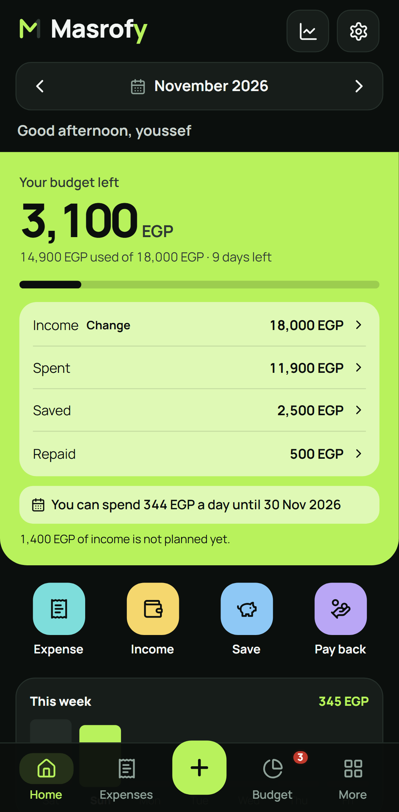
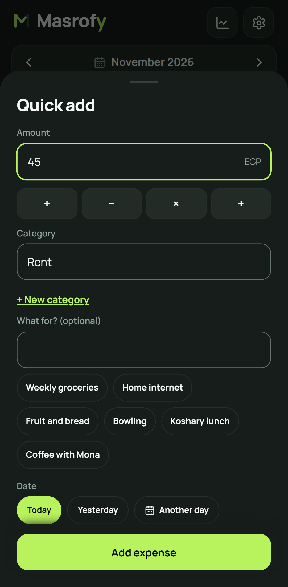
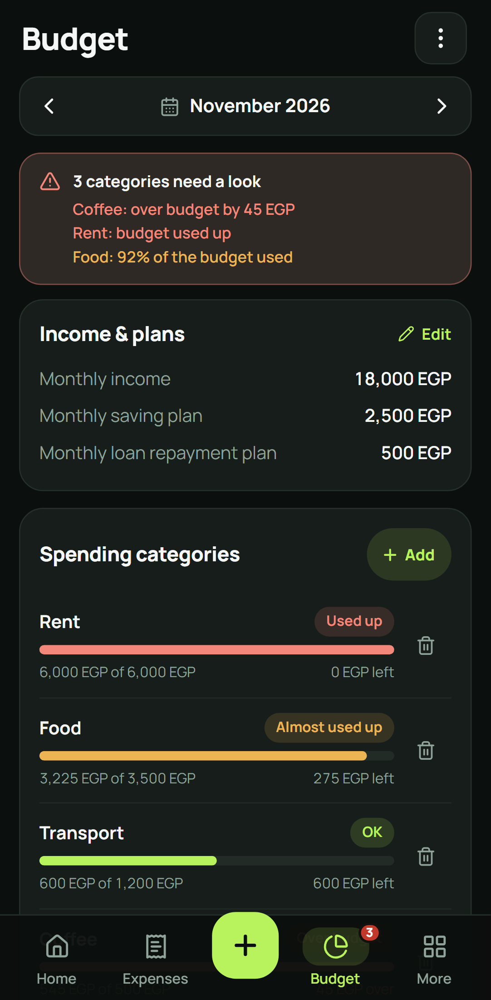
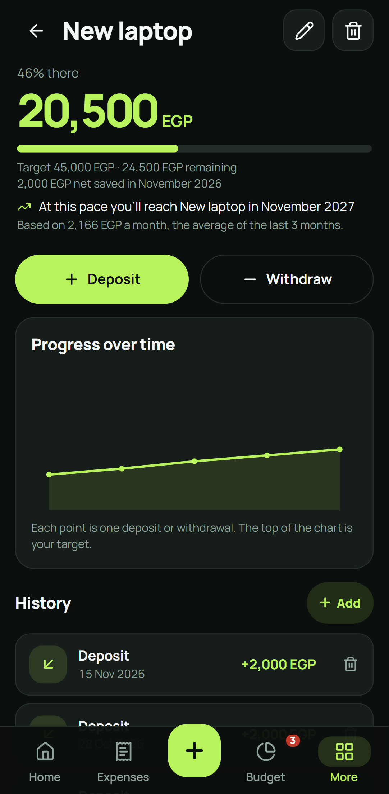

# Masrofy (مصروفي) · MK1 (version 2.4.0)

*See where every pound goes.*

<p>
  
  
  
  
</p>

Masrofy is a personal budget app for students and young earners, in **English and Egyptian Arabic**. Set your monthly income, log what you spend in seconds (even offline), see what is left and how much you can spend each day, save towards goals, keep track of money you lent or borrowed, and read monthly and yearly reports. (Screenshots: a demo account with made-up data.)

- **Android app:** download `masrofy-X.Y.Z.apk` from [GitHub Releases](https://github.com/ygyoussefgouda-art/Budget-Proj/releases) or from the site; it updates itself. Not on Google Play.
- **In a browser:** [masrofy.online](https://masrofy.online) works as an installable web app too.
- **Your data:** private to your account. No ads, no analytics, no trackers.
- **Licence:** [GPL-3.0](LICENSE). Developed by Youssef Gouda, with Mohamed Gouda.

> The app used to be called "Budget me". Its technical names (`com.budgetme.app`, the `budget-me` Docker project, `/opt/budget-me` in the deploy guide) stay as they were, so installed apps keep updating and running servers keep working.

## What's inside

| Screen | What you can do |
|---|---|
| **Home** | A lime band with your budget left this month, what you can spend per day until the month ends, and where the income went (spent, saved, repaid). Quick actions (Expense, Income, Save, Pay back), this week's spending per day, budget alerts (tap one to see that category's expenses), your savings goals, upcoming recurring payments, the top 3 categories and recent activity |
| **+ (centre of the bar)** | Quick add from any screen: amount (sums like `45+30` work), category (or a new one right there), what for (your usual descriptions as one-tap chips), Today / Yesterday / another day, and the time (filled in for you) |
| **Income** (Home) | Your monthly income plus extra income on top (freelance work, a gift, a bonus), which counts in the month it came in |
| **Expenses** | Every expense by day and time: search; filter by month, date range, category or #tag; edit, log again, delete with Undo (or swipe). Receipt photo or PDF, up to 5 #tags, "split with someone" (their share goes to Loans), paid in another currency. Recurring expenses (rent, subscriptions). Export to CSV or Excel |
| **Budget** | Monthly income and saving / repayment plans, a budget per category (or "per day" for uni or work days). Categories turn amber at 80% and red at 100%, with a badge on the tab. An empty month can copy the last one |
| **More → Savings** | Goals with progress, a chart and one forecast ("at this pace you'll reach it in July 2027"), with a warning when you're behind plan |
| **More → Loans** | "I owe" and "Owed to me": balance per person and the history |
| **More → Reports** | Where the money went this month, this month against last month per category, spending per weekday, per #tag, and the whole year month by month |
| **More → Settings** | Language, light or dark theme, the day your month starts, currency, app lock (PIN, plus fingerprint or face in the Android app), two-step sign-in, email, password, export, backup and restore, replay the tour, contact us, delete your account |

**First run:** a new account starts with a few everyday categories (Food, Transport, Coffee…, in your language) and a short tour: when you get paid, how much, an optional app lock, where things are, then your first expense.

**On the phone:** swipe a row left to delete it (with Undo) or right to edit it. Offline, the app opens with the data it last loaded and new expenses wait on the phone until you're back online (never sent twice). Long-press the app icon for an "Add expense" shortcut.

## The Android app

| | |
|---|---|
| Package | `com.budgetme.app` |
| Download | [GitHub Releases](https://github.com/ygyoussefgouda-art/Budget-Proj/releases): `masrofy-X.Y.Z.apk`, always signed with the same release key (certificate SHA-256 `55:11:EA:85:38:6C:29:98:CF:8C:43:6A:EF:77:68:23:54:D8:26:F3:43:0E:2E:26:1E:AE:F7:42:E4:50:3F:1A`) |
| Updates | The app checks its server, downloads the new APK, checks its SHA-256, package name and version, then opens Android's installer (you confirm) |

**How it works.** The app is a small [Capacitor](https://capacitorjs.com) shell ([`mobile/`](mobile)) around the web app, loaded from the Masrofy server, so every deploy updates its screens. You need an account: your budget is stored on that server and only your account can see it (every row belongs to one user; nothing is shared or public). Anyone can run their own server instead ([DEPLOY.md](DEPLOY.md)) and build the app against it.

**Privacy.** No ads, analytics, trackers or third-party SDKs. The fonts are bundled, and the server's Content-Security-Policy only lets the app talk to its own server (`connect-src 'self'`). Passwords are stored as scrypt hashes. The app lock PIN stays on the phone. If a screen crashes, the error message (not your data) is sent to the same server so it can be fixed. You can export your data or delete your account from Settings at any time.

**Permissions** (asked on first run, all optional; the app works without them):

| Permission | Why |
|---|---|
| `INTERNET`, `ACCESS_NETWORK_STATE` | Talk to the Masrofy server; notice when you're offline so expenses wait on the phone and sync later |
| `CAMERA` | Take a photo of a receipt |
| `POST_NOTIFICATIONS`, `RECEIVE_BOOT_COMPLETED` | Budget alerts, recurring expenses due and an optional daily reminder, also after a restart. All scheduled on the phone; nothing is pushed from a server |
| `USE_BIOMETRIC` | Unlock the app lock with your fingerprint or face (the PIN stays as the fallback) |
| `VIBRATE` | A short buzz when an expense is saved |
| `REQUEST_INSTALL_PACKAGES` | Let the app install its own updates |

**Build it yourself** (Node.js 22+, JDK 21 and the Android SDK):

```bash
cd mobile && npm ci
BUDGET_ME_URL=https://your-server npx cap sync android
cd android && ./gradlew assembleDebug        # test APK in app/build/outputs/apk/debug/
```

**Releases** are built by GitHub Actions ([.github/workflows/android.yml](.github/workflows/android.yml)): raise `versionCode` and `versionName` in `mobile/version.json`, push, then push the tag `android-vX.Y.Z`. The workflow checks the tag matches, signs the APK, refuses it unless it is signed with the release key, and attaches it to a GitHub Release. Setup: [DEPLOY.md](DEPLOY.md#android-app-sideloaded-not-on-google-play) and [docs/ANDROID_SELF_UPDATE.md](docs/ANDROID_SELF_UPDATE.md).

## How it's built

**React** (Vite, TypeScript) web app and a **Node.js API** (Express, TypeScript) on **PostgreSQL**, in **Docker** on a VPS, plus the Capacitor Android app. Emails ("Forgot password?" codes) go out from `no-reply@masrofy.online` through the app's own mail server.

```
web/        React app (mobile-first UI, installable web app)
server/     Node API, SQL migrations and API tests
mobile/     Android app (Capacitor shell around the live site)
e2e/        Playwright tests in a phone-sized browser
deploy/     VPS scripts (update, backups, restore, rollback) and reverse-proxy configs
docs/       specs and the store images (docs/store/)
Dockerfile  builds web + server into one small image
docker-compose.yml  app + Postgres (+ mail), isolated from anything else on the server
```

Working on the code (people or Claude): read `CLAUDE.md` first, then `PROGRESS.md` (what's done and next), `MEMORY.md` (decisions), `CODEMAP.md` (where things live) and `HANDOFF.md` (the Android phase plan).

## Run your own server (Docker)

**Full step-by-step guide: [DEPLOY.md](DEPLOY.md)** (firewall, secrets, HTTPS proxy, email, backups, updates).

Short version:

```bash
git clone https://github.com/ygyoussefgouda-art/Budget-Proj.git /opt/budget-me && cd /opt/budget-me
cp .env.example .env && chmod 600 .env && nano .env   # a strong POSTGRES_PASSWORD
docker compose up -d --build
curl http://127.0.0.1:8090/api/health                 # -> {"ok":true}
```

It is a standalone Compose project with its own network, Postgres and volume, so it shares nothing with other apps on the server. The app listens only on `127.0.0.1:8090`; put your HTTPS reverse proxy in front of it ([deploy/nginx-budget-me.conf](deploy/nginx-budget-me.conf) or [deploy/Caddyfile](deploy/Caddyfile)). Database backups run daily; update with `sh deploy/update.sh`.

### Accounts

- **Create account** needs an email, a username and a password typed twice (8+ characters with a lowercase and an uppercase letter, a number and a special character, ticked off as you type). Sign in with the username or the email.
- Each account has its own budget and nobody can see anyone else's. Sessions expire after 14 idle days (30 at most); sign-in and sign-up are rate-limited.
- **Forgot password?** emails a one-time code (set up in [DEPLOY.md](DEPLOY.md#email-forgot-password-codes-from-no-replymasrofyonline)); without email, an admin can make a reset code. Choosing a new password signs that account out everywhere.
- **Two-step sign-in** (Settings): a 6-digit code from any authenticator app, with 8 backup codes.
- Anyone who can open the app can sign up until you close sign-ups (`ALLOW_SIGNUP=false` in `.env`, or the Admin page).
- `APP_PASSWORD` (optional) creates a built-in `owner` account. **Admin page** (Settings → Admin, for `owner` and `ADMIN_USERNAMES`): list accounts, open or close sign-ups, remove an account, make one-time reset codes; every admin action is logged ([DEPLOY.md](DEPLOY.md#admin-page)).
- New accounts get the starter categories; set `STARTER_CATEGORIES=false` to start them empty. With `SEED_EXAMPLE_DATA=true` on a brand-new database, the built-in `owner` account starts with example data.

Run **one** app container: rate limits and a few guards are kept in memory per container.

**When something goes wrong:** a crashed screen shows "Something went wrong" with a **Reload** button instead of a blank page. A new deploy shows "A new version is ready" (**Reload** / **Later**). Server errors carry a short reference ("ref. 1a2b3c4d") that matches a line in `docker compose logs app`; the log never contains request bodies, passwords, cookies or codes. `GET /api/version` says which version is running.

## Develop locally

Requires Node.js 22+.

```bash
# API with an embedded Postgres (no Docker needed)
cd server && npm ci
DB_DRIVER=pglite PGLITE_DIR=.pglite npm run dev      # http://localhost:3000

# Web app (proxies /api to :3000)
cd web && npm ci
npm run dev                                           # http://localhost:5173
```

On Windows PowerShell, set the variables first: `$env:DB_DRIVER='pglite'; $env:PGLITE_DIR='.pglite'; npm run dev`. On the owner's PC a portable Node lives in `D:\devtools`: `scripts\dev-server.cmd` runs the whole app on http://localhost:3000, and `scripts\n.cmd npm …` runs any npm command.

**Tests**

```bash
cd server && npm test       # API tests against a real (embedded) Postgres
cd web && npm test          # budget maths
cd e2e && npm ci && npx playwright install chromium && npx playwright test   # build web first
```

GitHub Actions ([ci.yml](.github/workflows/ci.yml)) runs the API, web and E2E tests, a dependency audit and the Docker build on every push. Dependabot opens weekly update PRs.

Money is stored as whole minor units (piastres or cents), so there is no rounding drift.
